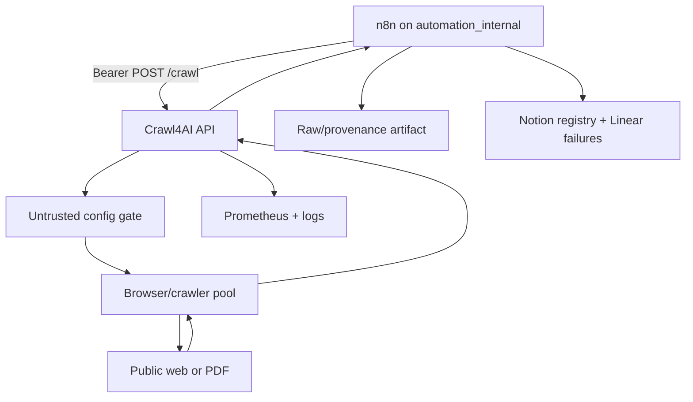

# CLAUDE.md — Crawl4AI Self-Hosted Gateway

## Overview
This fork turns Crawl4AI into a private n8n-facing extraction gateway. The audited baseline is clean v0.9.2 at `7e801521428ee12509994d39151006f64055ebe3`; production must be v0.9.3-derived or newer-safe. Preserve upstream architecture and change only what the strategy/SPEC requires.

## Stack
Python 3.10–3.13 · FastAPI/Gunicorn · Playwright/Patchright · Redis · Docker Compose · pytest · Black · GitHub Actions · n8n HTTP Request caller.

## VIZ-01 — Architecture
Private service topology keeps browser execution isolated from orchestration and persistence.

Alt text — n8n calls an authenticated private Crawl4AI API, which gates configs, executes crawls, emits metrics, and returns results for durable provenance and ops routing.

## Repository architecture
| Path | Responsibility |
|---|---|
| `crawl4ai/` | Core SDK, configs, strategies, browser lifecycle, extraction, filters |
| `crawl4ai/processors/pdf/` | PDF download, parsing, limits, HTML conversion; security-sensitive |
| `deploy/docker/server.py` | FastAPI routes, auth gate, request limits, MCP exposure |
| `deploy/docker/api.py` | Crawl request execution and config normalization |
| `deploy/docker/config.yml` | Runtime security/resource defaults |
| `deploy/docker/entrypoint.sh` | Redis secret + fail-closed socket bind |
| `deploy/docker/tests/` | Docker/security regression suite |
| `tests/unit/` | Focused core regression tests |
| `.github/workflows/` | CI/security/release supply chain |
| `Dockerfile`, `docker-compose.yml` | Container build and runtime posture |

## Patterns
- Treat request bodies and crawled content as untrusted.
- Keep `/crawl` request/response backward compatible with upstream v0.9.3.
- Keep n8n-specific provenance downstream; do not fork Crawl4AI's public response model without a failing test that requires it.
- Prefer small hardening overlays over framework rewrites.
- Every security fix needs a regression test before implementation is accepted.

## Bootstrap
`python -m pip install -e . && python -m pip install -r deploy/docker/requirements.txt pytest pytest-asyncio black`

## Commands
| Action | Exact command |
|---|---|
| Build | `docker build --build-arg C4AI_VER=0.9.3 --build-arg USE_LOCAL=true -t crawl4ai-self-hosted:0.9.3 .` |
| Test | `pytest -q` |
| Security test | `pytest deploy/docker/tests/test_security_*.py tests/unit/test_pdf_download_limits.py tests/unit/test_pdf_html_escaping.py -q` |
| Lint | `black --check crawl4ai deploy/docker tests` |
| Compile | `python -m compileall -q crawl4ai deploy/docker` |
| Deploy | `test -n "$CRAWL4AI_API_TOKEN" && (docker network inspect automation_internal >/dev/null 2>&1 || docker network create automation_internal) && IMAGE=crawl4ai-self-hosted:0.9.3 docker compose up -d crawl4ai` |
| Health | `docker compose exec -T crawl4ai curl -fsS http://127.0.0.1:11235/health` |

## Workflow
1. Branch from clean `main` as `build/crawl4ai-self-hosted-gateway`.
2. Preserve audited baseline branch `audit/v0.9.2-20260903` at `7e80152`.
3. Fetch upstream tags; fast-forward to v0.9.3. If fast-forward fails, stop and inspect divergence.
4. Commit one concern per commit using `type(scope): imperative summary`.
5. Open PR to `main`; required security/test/lint checks must pass before merge.
6. Review security-sensitive diffs in `deploy/docker/`, PDF processors, workflows, and dependency files line-by-line.
7. Never promote a build whose rollback target is v0.9.2.

## Key files
| File | Rule |
|---|---|
| `crawl4ai/__version__.py` | Must report 0.9.3 after upstream sync |
| `Dockerfile` | `C4AI_VER` must be 0.9.3; preserve non-root/read-only posture |
| `docker-compose.yml` | Require API token; private `automation_internal`; no production host port |
| `deploy/docker/config.yml` | Keep security enabled, 300s wall clock, bounded body/pages/depth, Redis-backed rate limiter, explicit trusted hosts |
| `deploy/docker/requirements.txt` | Preserve `mcp>=1.18.0,<2` until bridge migrates to MCP v2 |
| `deploy/docker/entrypoint.sh` | Preserve fail-closed bind when credentials are absent |

## NEVER run
- `git reset --hard`, `git clean -fdx`, or force-push `main` during this implementation.
- Production with `latest`, v0.9.2, `--privileged`, Docker socket mounts, disabled auth, or a host-published crawler port.
- `limits.wall_clock_s: 0`, unbounded PDF caps, `CRAWL4AI_HOOKS_ENABLED=true`, or `CRAWL4AI_EXECUTE_JS_ENABLED=true` for MVP.
- Retry storms against blocked/4xx targets.

## NEVER edit by hand
- `.git/**`.
- `sbom/sbom.cdx.json`; regenerate it through the project SBOM process.
- `uv.lock`; update it only through the package manager after intentional dependency changes.
- Historical release notes or security credits as part of this gateway build.

## Release blockers
Any failed AC-01 through AC-15, any P0/P1 security finding, any public crawler exposure, any missing bearer token, any silent n8n failure, or any unbounded post-traffic browser/process growth blocks production.
