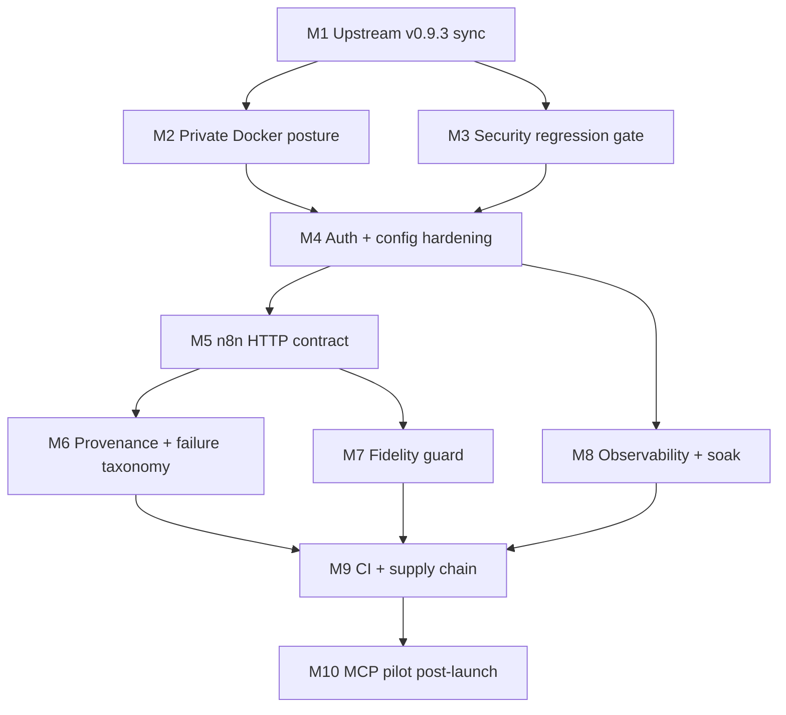

# SPEC.md — Crawl4AI Self-Hosted Gateway

## Contract
Build an internal n8n-facing Crawl4AI service from the clean v0.9.2 fork by upgrading to official v0.9.3, preserving the upstream `/crawl` API, removing public production reachability, requiring bearer auth, and adding evidence-backed release gates. Do not build a public SaaS, new UI, new crawler framework, or mandatory MCP dependency.

## VIZ-06 — Module dependency + build order
Build order keeps upstream security fixes and trust-boundary tests ahead of automation integration.



Alt text — Upgrade and security tests precede private runtime hardening; n8n, provenance, fidelity, soak, and CI converge before optional MCP work.

## Shared API contract

### `POST /crawl`
| Element | Contract |
|---|---|
| Authentication | `Authorization: Bearer $CRAWL4AI_API_TOKEN` |
| Request model | `CrawlRequestWithHooks` from upstream v0.9.3 |
| `urls` | list of 1–100 strings; production n8n MVP sends 1 URL per job for simple provenance/retry semantics |
| `browser_config` | optional dict; loaded as untrusted config |
| `crawler_config` | optional dict; loaded as untrusted config |
| `crawler_configs` | optional list of per-URL configs; not used by MVP n8n flow |
| `hooks` | omitted in MVP |
| Success | JSON object with `success` and `results`; n8n preserves complete raw body |
| Validation errors | 400/422, never blind-retry |
| Auth | 401/403, never retry until credential/config is corrected |
| Size/rate | 413/429, classify and delay or reject per workflow policy |
| Capacity | 503, retry with bounded exponential backoff |
| Deadline | 504, retry only when source policy allows and attempt budget remains |
| Server failure | 500/502, bounded retry; preserve correlation ID if returned |

### Downstream `CrawlRun` envelope
| Field | Type | Required | Source |
|---|---|---:|---|
| `run_id` | string | yes | n8n before request |
| `source_url` | URL | yes | input |
| `started_at`, `finished_at` | timestamp | yes | n8n |
| `crawler_version` | semver | yes | `/health` cache or deployment metadata |
| `config_fingerprint` | hash | yes | canonical JSON of request configs |
| `raw_response` | object | yes | Crawl4AI response |
| `raw_checksum` | hash | yes | canonical raw response bytes |
| `status` | enum | yes | `succeeded`, `failed_retryable`, `failed_terminal` |
| `failure_class` | enum/null | yes | HTTP/network/content classification |
| `artifact_ref` | reference/null | conditional | durable storage step |

## Module M1 — Upstream v0.9.3 sync
**Purpose** — Move the clean fork to the official security release without losing the audited v0.9.2 state.

**Inputs** — clean `main` at `7e801521428ee12509994d39151006f64055ebe3`; `upstream` remote; v0.9.3 tag.

**Outputs** — audit branch, main at official v0.9.3, version and Docker ARG 0.9.3.

**Error states** — dirty worktree, missing tag, non-fast-forward divergence, unexpected fork-only commits.

**Acceptance booleans**
- [ ] `git status --short` is empty before sync.
- [ ] `audit/v0.9.2-20260903` resolves to `7e80152`.
- [ ] `git merge --ff-only v0.9.3` succeeds.
- [ ] `crawl4ai/__version__.py` reports `0.9.3`.
- [ ] Dockerfile `C4AI_VER` is `0.9.3`.

**Claude Code prompt**
````text
Implement M1 only. Verify the repository is the clean audited v0.9.2 baseline at 7e801521428ee12509994d39151006f64055ebe3. Create audit/v0.9.2-20260903 at that commit, fetch upstream tags, inspect v0.9.2..v0.9.3, and fast-forward main to the official v0.9.3 tag. Stop rather than merge if fast-forward is impossible. Report the exact resulting SHA and the files changed by the upstream release. Do not add fork-specific code in this module.
````

## Module M2 — Private Docker posture
**Purpose** — Make Crawl4AI reachable to n8n on `automation_internal` without publishing the crawler port on the host.

**Data model** — Docker service `crawl4ai`; external bridge network `automation_internal`; internal endpoint `http://crawl4ai:11235`.

**Changes**
- Require `CRAWL4AI_API_TOKEN` with Compose required-variable syntax.
- Remove the host `ports` mapping from the production service.
- Attach `crawl4ai` to external network `automation_internal`.
- Preserve non-root user, read-only root, tmpfs writable areas, `cap_drop: ALL`, no-new-privileges, memory limit, PID limit, and health check.

**Edge/error handling** — network absent: deploy command creates it; token absent: Compose/deploy fails; health check runs inside service namespace.

**Acceptance booleans**
- [ ] `docker compose config` succeeds with token set.
- [ ] Rendered config has no host `ports` mapping for `crawl4ai`.
- [ ] Service is attached to `automation_internal`.
- [ ] Runtime still has read-only root, dropped capabilities, no-new-privileges, memory and PID limits.

**Claude Code prompt**
````text
Implement M2 only. Modify docker-compose.yml for an internal production gateway: CRAWL4AI_API_TOKEN must be required, crawl4ai must have no host-published port, and the service must attach to an external Docker network named automation_internal. Preserve all v0.9.3 least-privilege settings, tmpfs mounts, health check, memory limit, PID limit, restart policy, and appuser. Add or update tests/documentation only where needed to prove the rendered Compose topology. Do not add n8n as a service to this repository.
````

## Module M3 — Security regression gate
**Purpose** — Convert the five v0.9.3 blocker families into mandatory fork release evidence.

**Coverage**
| Family | Required proof |
|---|---|
| PDF arbitrary image-write | untrusted body cannot choose image output path or force expensive extraction |
| PDF SSRF | each redirect destination and final peer are constrained; private/link-local/metadata targets fail |
| PDF DoS | byte/page caps and wall-clock deadline remain finite |
| PDF HTML XSS | paragraph text is escaped in generated HTML |
| Playground DOM XSS | crawled text is not reparsed as live HTML |

**Acceptance booleans**
- [ ] Upstream v0.9.3 security tests are present.
- [ ] Security command in CLAUDE.md exits 0.
- [ ] No test is deleted, xfailed, or weakened to make the gate green.

**Claude Code prompt**
````text
Implement M3 only. Inventory the v0.9.3 regression tests covering PDF image writes, PDF redirect/peer SSRF, byte/page limits, PDF HTML escaping, and Playground DOM XSS. Ensure the fork's security workflow executes every applicable test family. Add a focused regression test only when a listed family is not already exercised by the upstream suite. Do not weaken fixtures, marks, assertions, or error expectations.
````

## Module M4 — Auth + runtime config hardening
**Purpose** — Configure the fork for internal authenticated operation without weakening v0.9.3 safe defaults.

**Required config**
| Setting | Target |
|---|---|
| `app.host` | `0.0.0.0` so the authenticated service can accept private-network traffic |
| `limits.wall_clock_s` | `300` |
| body/pages/depth | preserve v0.9.3 finite defaults |
| `rate_limiting.storage_uri` | `redis://localhost:6379` |
| `security.enabled` | `true` |
| `security.jwt_enabled` | `false` for service-to-service MVP |
| `security.trusted_hosts` | `crawl4ai`, `localhost`, `127.0.0.1` |
| CORS | empty deny-by-default list |
| hooks / execute JS | disabled by environment/default |

**Error states** — token absent, unexpected Host, private destination, oversize body, timeout, rate limit.

**Acceptance booleans**
- [ ] Service refuses non-loopback bind without a credential.
- [ ] Valid bearer token reaches `/crawl`.
- [ ] Missing/invalid token fails.
- [ ] Host guard accepts `crawl4ai` and rejects an untrusted Host.
- [ ] 300s deadline and finite limits are visible in effective config.

**Claude Code prompt**
````text
Implement M4 only. Harden deploy/docker/config.yml for the internal Docker service while preserving upstream v0.9.3 behavior: app.host 0.0.0.0, wall_clock_s 300, finite body/page/depth limits, Redis-backed rate limiting, security enabled, JWT disabled for MVP static-token auth, trusted_hosts exactly crawl4ai/localhost/127.0.0.1, and deny-by-default CORS. Do not enable hooks, execute_js, insecure TLS, or unbounded limits. Extend tests to validate effective configuration and Host/auth failure paths.
````

## Module M5 — n8n HTTP contract
**Purpose** — Give n8n one deterministic supported production call path without changing upstream response semantics.

**Request**
````json
{
  "urls": ["https://example.com"],
  "browser_config": {},
  "crawler_config": {
    "stream": false,
    "cache_mode": "bypass"
  }
}
````

**n8n behavior**
| Condition | Action |
|---|---|
| 2xx + valid result | normalize, checksum, persist provenance |
| network/500/502/503/504 | bounded exponential retry; max 3 attempts [A] |
| 429 | honor `Retry-After` if present; max 3 attempts [A] |
| 400/401/403/413/422 | terminal; no blind retry |
| malformed response | terminal data-contract failure |

**Integration points** — header `Authorization: Bearer ...`; `run_id` created before call; base URL `http://crawl4ai:11235`; secret stored in n8n credentials, never workflow export.

**Acceptance booleans**
- [ ] Contract doc includes request, response classes, error taxonomy, retry matrix, and provenance fields.
- [ ] Test fixture proves at least one 2xx, 4xx, 5xx/504, and malformed-response path.
- [ ] Crawl4AI API response shape itself is not forked for n8n.

**Claude Code prompt**
````text
Implement M5 only. Add a repository integration contract for n8n calling POST /crawl at the internal service DNS crawl4ai:11235 with Bearer token auth. Keep the upstream API unchanged. Document and test the exact request shape, status classification, bounded retry rules, and required downstream run_id/provenance fields. Include sanitized fixtures for 2xx, terminal 4xx, retryable server/timeout failure, and malformed response. Do not embed any credential value.
````

## Module M6 — Provenance + failure taxonomy
**Purpose** — Ensure every downstream artifact is evidence-traceable and every failure is classifiable.

**Data model** — `CrawlRun` and `FailureRecord` exactly as defined in strategy S3.

**Failure classes** — `validation`, `auth`, `rate_limit`, `capacity`, `deadline`, `network`, `server`, `content_contract`, `blocked_target`, `unknown`.

**State** — downstream state lives in n8n/storage, not Crawl4AI. Use deterministic `run_id`; hash canonical request config and raw response; preserve source/fetch/version metadata.

**Acceptance booleans**
- [ ] One run can be reconstructed from run ID to request, raw response, checksums, registry record, and failure issue if present.
- [ ] Secrets and raw Authorization headers never enter provenance.
- [ ] Retry exhaustion yields terminal failure evidence.

**Claude Code prompt**
````text
Implement M6 only as contract tests and documentation inside the repository. Define the CrawlRun provenance fields and failure taxonomy used by n8n without adding server-side persistence to Crawl4AI. Provide deterministic canonicalization/hash examples and fixtures. Assert that secrets and Authorization headers are excluded. Add a forced retry-exhaustion example that shows the data required to create or update a Linear issue downstream.
````

## Module M7 — RAG fidelity guard
**Purpose** — Prevent extraction upgrades or filters from silently destroying technical content.

**Fixtures** — static HTML with syntax-highlighted `pre/code`, dynamic-page fixture, duplicate/canonical URL case, low-value navigation, and PDF text with escaped markup.

**State approach** — compare raw source, `raw_markdown`, and filtered/fit output; mark a result invalid rather than silently indexing when a critical fixture fails.

**Acceptance booleans**
- [ ] Every critical fixture has deterministic expected structural assertions.
- [ ] Code block whitespace/content survives the chosen production config.
- [ ] A failing fit result can fall back to raw Markdown.
- [ ] Source checksum and crawler version are attached to test output.

**Claude Code prompt**
````text
Implement M7 only. Build a small offline golden corpus focused on technical-page fidelity: syntax-highlighted pre/code whitespace, dynamic content readiness, duplicate/canonical handling, noisy navigation, and PDF text escaping. Test raw_markdown against the production filtered output. Treat loss of critical code structure as a failure and document raw_markdown fallback. Keep fixtures local and deterministic; do not depend on public websites in the release gate.
````

## Module M8 — Observability + resource soak
**Purpose** — Detect browser lifecycle/resource regressions before they become long-lived host failures.

**Signals** — request outcome/latency, renderer/browser process count, cgroup memory, CPU saturation, 429/504, auth/SSRF denials, queue age.

**Soak protocol** — run the 20-job representative set, stop traffic, continue sampling process count and memory for a defined cooldown window, and fail if the system shows monotonic unbounded growth rather than returning to a stable band. [A]

**Acceptance booleans**
- [ ] Prometheus and logs expose correlation-ready request outcomes.
- [ ] Soak evidence records time-series process and memory observations.
- [ ] Post-traffic state returns to a bounded stable band defined from the run itself, not an invented universal number.

**Claude Code prompt**
````text
Implement M8 only. Add an executable soak/health validation that records crawl outcomes, latency, Chromium/renderer process count, and container memory while running the representative workload and after traffic stops. Do not invent a universal process or latency limit. Fail on monotonic unbounded growth, crash/OOM, missing health, or unrecovered queue. Store the evidence as CI/test artifacts where the environment supports it.
````

## Module M9 — CI + supply-chain release gate
**Purpose** — Make the deployed fork reproducible and prevent mutable automation from bypassing security evidence.

**Changes**
- Disable the nonessential Discord notification workflow that uses `Ilshidur/action-discord@master`.
- Resolve every required `uses:` action to a reviewed full-length commit SHA and pin it.
- Add/retain security, test, Black check, secret scan, dependency scan, CodeQL, image/SBOM scan, and SBOM generation.
- Use minimum workflow permissions.

**Acceptance booleans**
- [ ] No enabled workflow contains `@master`, `@main`, or a movable tag for a required action.
- [ ] Security/test/lint/scans are required before release promotion.
- [ ] Generated SBOM is retained and not hand-edited.
- [ ] P0/P1 findings are zero.

**Claude Code prompt**
````text
Implement M9 only. Disable the nonessential Discord workflow that executes Ilshidur/action-discord@master. For every enabled required workflow action, resolve the official action repository tag to its current full 40-character commit SHA, verify origin, and pin to that SHA. Add explicit minimum permissions. Ensure CI runs the project tests, security suites, Black check, secret scan, dependency vulnerability scan, CodeQL, image/SBOM scan, and SBOM generation. Do not suppress P0/P1 findings to make CI pass.
````

## Module M10 — MCP pilot [P2, post-launch]
**Purpose** — Validate the upstream MCP bridge without making it a launch dependency.

**Dependencies** — M1–M9 production HTTP path stable; `mcp>=1.18.0,<2` retained.

**Tests** — tool discovery, strict schema client, `ask` behavior or exclusion, bearer auth, transport connection, one crawl, invalid URL error, two concurrent calls, process cleanup.

**Acceptance booleans**
- [ ] Exact target client loads intended tools without rejecting the schema.
- [ ] Auth and error paths do not collapse the session.
- [ ] Concurrent calls do not introduce process/session leaks.
- [ ] HTTP API remains available as rollback path.

**Claude Code prompt**
````text
Implement M10 only after M1-M9 are green. Validate the existing v0.9.3 MCP bridge against the exact intended client. Preserve mcp<2. Reproduce the strict-client ask-schema issue if present; fix or exclude only that tool without changing the working HTTP API. Test discovery, auth, transport, one crawl, invalid URL, two concurrent calls, and cleanup. MCP failure must not block or alter the production HTTP path.
````

## MVP build order
1. M1 Upstream v0.9.3 sync.
2. M3 Security regression gate.
3. M2 Private Docker posture.
4. M4 Auth + runtime config hardening.
5. M5 n8n HTTP contract.
6. M6 Provenance + failure taxonomy.
7. M7 RAG fidelity guard.
8. M8 Observability + resource soak.
9. M9 CI + supply-chain release gate.
10. Production acceptance gate; M10 only after launch.

## Integration event contracts
| Event | Producer | Consumer | Minimum payload |
|---|---|---|---|
| `crawl.requested` | n8n | Crawl4AI | run_id, URL, config fingerprint |
| `crawl.succeeded` | n8n adapter | artifact/registry/RAG | run_id, source, version, raw response/checksum |
| `crawl.retrying` | n8n adapter | observability | run_id, failure_class, attempt, next delay |
| `crawl.failed` | n8n adapter | registry + Linear | run_id, class, attempts, evidence ref |
| `deployment.promoted` | release workflow | operator | version, commit, image identity, config revision, test evidence |
| `deployment.rolled_back` | operator | registry | from/to safe artifacts, reason, evidence |

## Done
All strategy AC-01 through AC-15 pass, no P0/P1 security finding remains, and the production score is ≥90/100.
