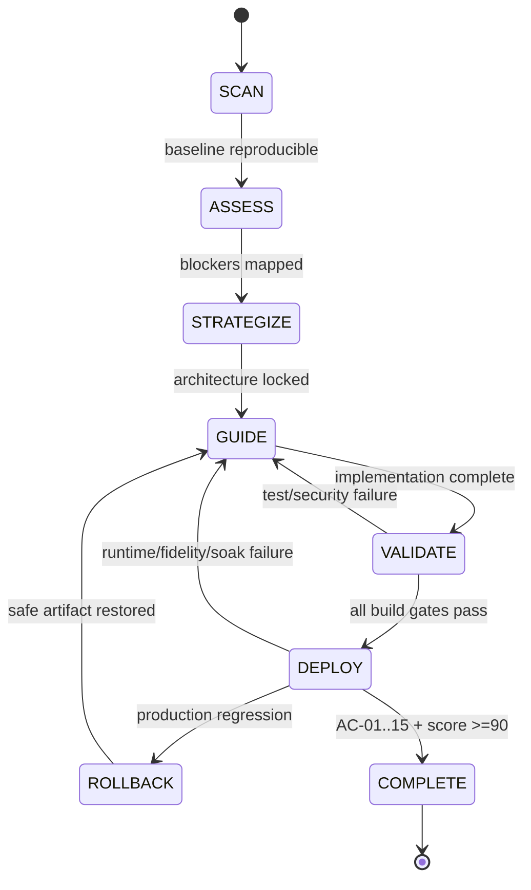

# RUNBOOK.md — Crawl4AI Self-Hosted Gateway

## Operating rule
Execute phases in order. A failed gate sends the work to the named rollback/recovery path; never skip ahead because the code “looks right.” Production means all AC-01–AC-15 pass and the revised score is ≥90/100.

## VIZ-07 — Phase/session state machine
Every failed build or deploy gate routes backward to a safe evidence or implementation state.



Alt text — Work advances from evidence to strategy, build validation, and deploy; failures return to GUIDE or explicit safe rollback before completion.

## Phase 1 — SCAN
**Objective** — Prove the starting repository identity before any mutation.

**Claude Code prompt**
````text
Execute SCAN only. Read CLAUDE.md, SPEC.md, and this RUNBOOK. Verify HEAD, tag, remotes, branch tracking, and clean status. Confirm HEAD is 7e801521428ee12509994d39151006f64055ebe3 tagged v0.9.2 and upstream is unclecode/crawl4ai. Inventory the exact files that v0.9.3 changes using git log/diff after fetching tags. Write the evidence to docs/implementation/scan-evidence.md. Make no source-code changes.
````

**Tests**
`git status --short && git rev-parse HEAD && git describe --tags --exact-match HEAD && git remote -v`

**Pass bar** — clean worktree; exact audited SHA/tag; both remotes correct; v0.9.3 tag fetched.

**Rollback** — none required because SCAN is read-only. If identity differs, stop and reconcile source provenance before continuing.

## Phase 2 — ASSESS
**Objective** — Lock blocker risks and acceptance evidence against the exact v0.9.2→v0.9.3 delta.

**Claude Code prompt**
````text
Execute ASSESS only. Compare v0.9.2..v0.9.3 and map every changed security-sensitive file to AC-01–AC-15. Confirm the five release-note security families and identify their regression tests. Record any fork-specific divergence or new upstream issue that changes the threat model. Write docs/implementation/assess-evidence.md. Do not implement fixes yet.
````

**Tests**
`git diff --stat v0.9.2..v0.9.3 && git log --oneline v0.9.2..v0.9.3`

**Pass bar** — five blocker families mapped to code/tests; no unexplained divergence; confidence remains ≥95%.

**Rollback** — if evidence conflicts, return to SCAN and update the source baseline; do not infer missing facts.

## Phase 3 — STRATEGIZE
**Objective** — Freeze the minimal production architecture and change set before coding.

**Claude Code prompt**
````text
Execute STRATEGIZE only. Confirm the implementation will keep the upstream /crawl API, use n8n over automation_internal at crawl4ai:11235, require Bearer token auth, publish no production crawler port, keep hooks/execute_js off, and keep MCP post-launch. Create docs/implementation/plan.md with ordered modules M1-M9, files expected to change, tests per module, and rollback points. Do not modify production code.
````

**Pass bar** — plan contains no public/multi-tenant requirement, no v0.9.2 rollback target, no unbounded limit, and no new server-side persistence layer.

**Rollback** — revise strategy/SPEC if a required capability cannot be implemented without violating the constraints.

## Phase 4 — GUIDE
**Objective** — Implement M1–M9 with one reviewable concern per commit.

### GUIDE-1 — Upgrade
**Claude Code prompt**
````text
Execute M1 from SPEC.md. Preserve the audit branch, fast-forward to v0.9.3, verify version files, and run compileall. Commit only the upstream sync as chore(upstream): sync Crawl4AI v0.9.3 security release.
````

**Gate** — fast-forward succeeded; version 0.9.3; compileall exits 0.

**Rollback** — reset only the feature branch to its pre-sync commit if the sync has not been merged; audited baseline branch remains untouched.

### GUIDE-2 — Security tests before custom hardening
**Claude Code prompt**
````text
Execute M3 from SPEC.md before custom Docker changes. Run the upstream v0.9.3 security/PDF suites, map them to the five blocker families, and make the workflow fail if any family fails. Do not change behavior just to satisfy tests.
````

**Gate** — security command exits 0; no skipped blocker family.

**Rollback** — investigate target/environment; do not revert to v0.9.2.

### GUIDE-3 — Private runtime + config
**Claude Code prompt**
````text
Execute M2 and M4 from SPEC.md. Make the Compose service private on automation_internal, require CRAWL4AI_API_TOKEN, preserve least privilege, and set the exact production config values in M4. Add tests for rendered topology, auth, Host guard, effective limits, and fail-closed behavior. Commit as feat(deploy): harden private Crawl4AI gateway.
````

**Gate** — Compose config valid; no host crawler port; token required; security tests remain green.

**Rollback** — revert only the private-runtime commit; retain v0.9.3 and security tests.

### GUIDE-4 — n8n/provenance/fidelity
**Claude Code prompt**
````text
Execute M5, M6, and M7. Add the n8n HTTP contract, status/retry taxonomy, provenance schema/fixtures, and offline golden fidelity corpus. Keep the upstream /crawl API unchanged and keep provenance downstream. Commit as feat(integration): lock n8n crawl and provenance contract.
````

**Gate** — contract fixtures pass; no secret material; critical code fixtures preserved; raw fallback tested.

**Rollback** — revert integration-contract changes without altering the secure Crawl4AI runtime.

### GUIDE-5 — Observability + supply chain
**Claude Code prompt**
````text
Execute M8 and M9. Add the soak/resource validation, disable the mutable nonessential Discord workflow, pin enabled required actions to reviewed full SHAs, minimize workflow permissions, and add the required source/dependency/image/SBOM/secrets checks. Commit as ci(security): enforce release evidence and supply-chain gates.
````

**Gate** — enabled workflows contain no mutable required action refs; CI/security/lint/scans pass; soak harness is executable.

**Rollback** — revert only newly introduced CI configuration causing false infrastructure failures; never disable security checks to obtain green status.

## Phase 5 — DEPLOY
**Objective** — Prove the exact build under private runtime, n8n workload, fidelity, soak, and rollback before promotion.

### Deploy build
`docker build --build-arg C4AI_VER=0.9.4 --build-arg USE_LOCAL=true -t crawl4ai-self-hosted:0.9.4 .`

### Deploy private service
`set -a && . ~/.config/crawl4ai-gateway/gateway.env && set +a && (docker network inspect automation_internal >/dev/null 2>&1 || docker network create automation_internal) && IMAGE=crawl4ai-self-hosted:0.9.4 docker compose up -d crawl4ai`

### Health
`docker exec crawl4ai-crawl4ai-1 curl -fsS http://127.0.0.1:11235/health` (works without exporting the token; `docker compose exec` needs it for interpolation)

### DEPLOY Claude Code prompt
````text
Execute DEPLOY validation only. Build the exact 0.9.3-derived image, deploy it on automation_internal with a pre-existing CRAWL4AI_API_TOKEN, confirm no host crawler port, then run the release test/security suite, 20 representative n8n-equivalent requests, forced retryable and terminal failures, provenance checks, golden fidelity corpus, and post-traffic resource soak. Record version, commit, image identity, config revision, test outputs, and AC-01–AC-15 in docs/implementation/deploy-evidence.md. Do not promote if any must-pass criterion fails.
````

**Pass bar** — AC-01 through AC-15 all PASS; revised score ≥90/100; no P0/P1 finding; private/authenticated path only.

**Rollback drill**
1. Record current safe image identity before promotion.
2. Introduce a controlled health failure in a non-production validation run or select the prior safe build.
3. Stop new n8n jobs.
4. Redeploy `crawl4ai-self-hosted:0.9.4-known-safe` (`IMAGE=crawl4ai-self-hosted:0.9.4-known-safe docker compose up -d --force-recreate crawl4ai`; drilled 2026-10-09: 16.5 s to healthy).
5. Verify health, auth, one crawl, and n8n contract.
6. Record from/to artifact IDs and reason.
7. Never roll back to v0.9.2 or v0.9.3 (both carry advisories fixed in v0.9.4).

## Operations (v0.9.4 gateway)

### Secrets
The gateway token lives outside the repo in `~/.config/crawl4ai-gateway/` (dir 0700, files 0600):
`gateway.env` (`CRAWL4AI_API_TOKEN=...`, sourced for the gateway compose) and `api_token`
(the bare token, mounted into the console as a compose secret). Both hold the same value.

**Rotate:** generate a new token into both files, redeploy the gateway (Deploy private service),
recreate the console with `--force-recreate`, then update the n8n credential.
n8n jobs fail with `auth` until the credential is updated, so stop scheduled jobs first.

### n8n wiring (n8n-docker repo)
n8n joins `automation_internal` and allows exactly one SSRF hostname, `N8N_SSRF_ALLOWED_HOSTNAMES=crawl4ai`.
With `N8N_SSRF_PROTECTION_ENABLED=true` the default blocklist covers 172.16.0.0/12, so without that
exception the HTTP Request node is refused. Verified 2026-10-09 in an isolated n8n container:
`crawl4ai` by name allowed; the gateway by IP and 169.254.169.254 both `SsrfBlockedIpError`.

### Operator console
`CRAWL4AI_API_TOKEN_FILE=~/.config/crawl4ai-gateway/api_token CONSOLE_IMAGE=crawl4ai-console:0.9.4 docker compose -f deploy/ui/compose.yml up -d --build`,
then open http://127.0.0.1:8501. Pages: Status, Crawl (through the n8n contract), History
(provenance only, never page bodies), Self-test (version floor, auth, GHSA-5w5p, metadata SSRF).
It has no login of its own: keep the loopback bind.

### Release gates to run before promotion
1. `pytest deploy/docker/tests --ignore-glob='deploy/docker/tests/test_[0-9]_*.py' tests/unit/test_pdf_*.py tests/unit/test_config_provenance.py tests/unit/test_egress_policy.py tests/unit/test_robots_query_rules.py tests/gateway -q`
2. Image dependency gate, for both images: `pip list --format=freeze` from the image (not `pip freeze`, which hides pip and setuptools) → `pip-audit -r … --no-deps --disable-pip --format json` → `deploy/gateway/audit_gate.py`.
3. E2E from n8n's namespace: `docker run --rm --network container:n8n-n8n-1 -e CRAWL4AI_API_TOKEN -v "$PWD/deploy:/w/deploy:ro" python:3.12-slim-bookworm python /w/deploy/gateway/e2e.py --base-url http://crawl4ai:11235 --runs 20`.
4. Concurrent soak: `python deploy/gateway/soak.py --container crawl4ai-crawl4ai-1 --jobs 60 --concurrency 4 --cooldown-s 720`.
   Cooldown must exceed the hot-pool idle TTL (2 × `idle_ttl_sec` = 600 s) plus one janitor interval (60 s), or a pooled browser is still legitimately alive.

## Session operations
| Situation | Claude Code action |
|---|---|
| Starting a new ASGD phase | `/clear`, then load `CLAUDE.md`, `SPEC.md`, `docs/RUNBOOK.md`, and the prior phase evidence file |
| Mid-module context is noisy but decisions are still active | `/compact` after writing current state and unresolved checks to the phase evidence file |
| Security/test failure changes the implementation plan | Write the failure and new plan to `docs/implementation/plan.md`, then `/clear` and restart from that file |
| More than one module has become entangled | Stop; commit or revert the completed concern, write handoff, start fresh session |
| Before DEPLOY | Always start fresh after GUIDE is merged/green; do not carry speculative context into release validation |

## Handoff protocol
1. Before ending any session, write current phase, exact commit, changed files, tests run/results, open failures, and next atomic action to `docs/implementation/handoff.md`.
2. Commit the handoff when it describes a durable decision/evidence state.
3. Start a fresh Claude Code session.
4. Load `CLAUDE.md`, `SPEC.md`, `docs/RUNBOOK.md`, then `docs/implementation/handoff.md`.
5. Resume only the stated next atomic action; revalidate HEAD before edits.

## Phase test matrix
| Phase | Tests | Pass bar |
|---|---|---|
| SCAN | Git identity/status/tag/remotes | exact audited baseline |
| ASSESS | v0.9.2..v0.9.3 diff/test mapping | 5/5 blocker families mapped |
| STRATEGIZE | plan inspection | no threat-model contradiction |
| GUIDE-1 | compileall + version | exit 0 + 0.9.3 |
| GUIDE-2 | security/PDF regression suites | 100% blocker tests pass |
| GUIDE-3 | Compose/auth/Host/config tests | private + fail closed |
| GUIDE-4 | contract/provenance/golden fixtures | 0 silent contract failures; critical fixtures pass |
| GUIDE-5 | lint + CI/security/scans | all required checks green; 0 P0/P1 |
| DEPLOY | 20 E2E + forced failures + soak + rollback | AC-01..15 PASS and score ≥90 |

## Done
Done is not “container is running.” Done means the strategy North Star release set is 100%, AC-01–AC-15 pass, the 20-run set has zero silent failures, critical fidelity fixtures pass, security P0/P1 findings are zero, process/memory returns to a bounded post-traffic band, rollback works, and the evidence-based production score is ≥90/100. Latency, safe concurrency, steady-state SLO, and infrastructure cost remain measured post-launch outputs rather than invented launch claims.
